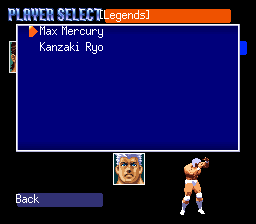
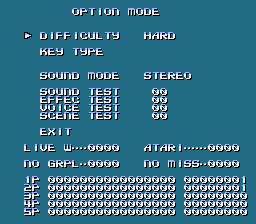
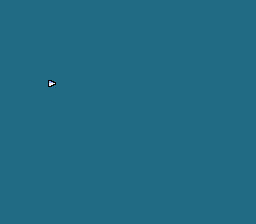
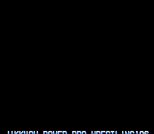

# Hidden content

Unlockables, debug features, button codes and unused content, each marked *verified in game* or
*from the code*. Addresses are CPU addresses in the original Japanese ROM. Nothing here is
changed by the translation patch.

Existing guides list three secrets: the Legends group (below), a first strike before the bell
(press L while the wrestlers wait for the gong, then run at the opponent), and a Cyclone Clutch
that keeps working when the opponent escapes. The Cutting Room Floor has no page for this game.
Everything else here is new.

## Contents
- [Legends: Max Mercury and your own wrestler](#legends-max-mercury-and-your-own-wrestler)
- [Button code: Legends without finishing Max Voltage](#button-code-legends-without-finishing-max-voltage)
- [Debug menu ("OPTION MODE")](#debug-menu-option-mode)
- [Credits viewer](#credits-viewer)
- [Cheat codes](#cheat-codes)
- [Moves](#moves)
- [Leftover debug code](#leftover-debug-code)
- [Unused text](#unused-text)

## Legends: Max Mercury and your own wrestler
Finish a Max Voltage career (all five years, belts or not) and the wrestler select in Versus,
Tournament and League gets a fifth group, **Legends**, after Super Japan, WWK, BOM and REAL'S.
It holds Max Mercury and the wrestler you played the career with. *(verified in game)*

How it works *(from the code)*: when the career ends, `$91:F323` writes 1 to SRAM byte
`$70:000F`. At power-on (`$80:8671`) that byte is copied to `$1FEB`, and the wrestler select
(`$8D:F32D`) shows five groups instead of four when `$1FEB` is set. Finished wrestlers are kept
in SRAM as wrestler ids `$34`-`$3A` (seven slots, `$91:AD1F`); Max Mercury is id `$33`.

## Button code: Legends without finishing Max Voltage
On the title screen, while GAME START is showing, **hold Up on controller 1 and press Up on
controller 2**, then press Start. Max Mercury is then in the Legends group for this session. The code sets only
`$1FEB`, not the SRAM byte, so it lasts until the console is switched off.
*(verified in game: the code sets `$1FEB` and the Legends group appears)*

The check is `$80:9852`, called every frame while the title screen waits for Start (`$80:9700`): controller 1 held
(`$20`) has Up and controller 2 newly pressed (`$2E`) has Up → `$1FEB` = 1. Without a finished
career in the save, the group holds only Max Mercury.

## Debug menu ("OPTION MODE")
A complete debug menu is still in the game, but nothing in normal play can open it.
*(verified in game, opened with the cheat code below)*

The title screen's menu has one item, GAME START, but its cursor (`$68`) is still checked when
Start is pressed (`$80:97B7`): 0 starts the game, 2 opens the [credits viewer](#credits-viewer),
4 or more opens this menu (main state 8, `$8D:A07B`). The cursor code is told the menu has one
item (`$80:970B` `LDA #$0002`), so the cursor stays at 0: the other entries were removed from
the title, but not their code. In the menu, Up/Down pick an item, Left/Right change it, A/B play
the selected sound, Select or Start leaves.

| Item | What it does *(from the code, `$8D:A1FE` table)* |
|---|---|
| DIFFICULTY | three levels (`$1F9C`), the same setting as the normal Option screen |
| KEY TYPE | nothing: the handler is an empty `RTL` |
| SOUND MODE | STEREO / MONAURAL (`$1F9A`) |
| SOUND TEST | 22 pieces of music (numbers in hex); A or B plays one |
| EFFEC TEST | 70 sound effects |
| VOICE TEST | 467 voice clips (the commentary) |
| SCENE TEST | stores a number in `$18` and nothing else: the scene player is gone |
| EXIT | back to the intro |
| LIVE W, ATARI, NO GRPL, NO MISS | switches (`$1FF8`, `$1FFA`, `$1FFC`, `$1FFE`). Only NO GRPL is still read: when it is set, the match loop (`$80:A255`) skips `$8D:917D`, which runs for wrestlers in states `$04`-`$09`, probably the grapple contest. LIVE W, ATARI (Japanese slang for hit detection) and NO MISS are read nowhere. |
| 1P-5P rows | a live display of each controller's bits, multitap included |

The values change and the screen updates *(verified in game)*; the sounds couldn't be heard in
the test runs, so playback is *from the code*.

## Credits viewer
Title cursor 2 (main state 9, `$80:C3B6`) is a two-item menu whose labels are lost: its text
table points into code, so only the cursor shows. Both items start the staff credits roll.
*(verified in game)*

## Cheat codes
Pro Action Replay codes (they write RAM every frame). *(verified in game by writing the same
values)*

| Code | Effect |
|---|---|
| `7E006804` | Turn on at the title screen, press Start: the debug menu. Turn it off afterwards (`$68` is a cursor many menus use). |
| `7E006802` | The same for the credits viewer. |
| `7E1FEB01` | The Legends group (Max Mercury), like the button code. |

## Moves
*(from the code and data tables; not played)*

- **Movesets**: a pointer per wrestler at `$81:F43F` (ids 1-51) to a 64-byte record in bank `$87`
  (`$87:C874`-`$87:D4F4`), one byte per move (move id ÷ 2, names from the table at `$82:E794`).
  Ids 52-58 point into SRAM (the finished Max Voltage wrestlers) and id 59 to WRAM `$7E:5110`
  (the current Max Voltage wrestler). A new Max Voltage wrestler starts from one of nine
  64-byte templates at `$87:DCC6`-`$87:DEC6`, picked by sports background (`$7E:51F6`, 0-9 in the
  entry form's order) through the pointer list at `$81:FC40` and copied by `$91:DA7B`; Track and
  None share the plain template. Starting height, weight and abilities come from `$81:FC54`
  (10 records of 38 bytes, copied by `$91:D9F3`).
- **Move properties**: 8 bytes per move set byte at `$82:C431` (read by `$8D:A597`): difficulty
  0-9; type (`$80` strike, `$40` submission, `$20` throw) and body part; damage 1-18; side-effect
  odds as a random mask (1 in mask+1, from 1/1 to 1/256); the effect (bit 7 injury, likely 6
  confusion and 5 bleeding); probably the reversal and the damage a missed dive does to you.
- **Move set slots**: the Edit Moves pages (`$83:BCB4`) give each of the 64 bytes a situation;
  `tools/guidedata.py` holds the full map and writes every wrestler's move set into the player's
  guide. Bytes 24-27, 37 (a copy of 36), 42 and 43 are not move slots.
- **League points** (`$8D:C386`, table `$82:EDBB`): 5 for a win by pinfall, KO or TKO; 3 for a
  win by submission, count-out or disqualification; 1 for a draw; 0 for a loss.
- **Two moves nobody can use**: *Weapon Attack* and *Tackle* have names and are in the Max
  Voltage learning table (cost 0, so "learned" from the start), but no wrestler has them and no
  Edit slot accepts them.
- **Moves without a name**: move ids `$10E` and `$172` are not in the move table. The match input
  code sets them directly (`$8D:9570`, `$8D:951E`), so they are probably built-in basic actions.
- **Everything else can be learned.** The learning table (`$83:C102`, 187 pairs of price and move)
  sells every named move, the specials included: Psychic 20 points, Poison Mist 80, Fire Breath
  100, Illegal Driver 150, Captured 200, and Saizo Special, Phoenix Splash, Splash Mountain and
  Cyclone Clutch at 300. Each Edit slot has its own list of allowed moves (`$83:BEE5`): Poison
  Mist and Fire Breath only fit the "big hit" slot.
- **Signature moves** (only one wrestler has each): Spring Suicida and Dr. Bomb (Doctor Myst),
  Spring Lariat (L. Tatsumi), Fire Breath (Abra Kadabra), Illegal Driver (Terror Temujin), Tiger
  Suplex (K. Nagata), Exploder (Koji Narumi), TF Powerbomb (Nagato Bando), Backdrop Bomb (Mega
  King), Half Arm Suplex (Masked Robo), STF (Tsukio Inugami), Kneebar (Yu Shiina). Max Mercury
  has no move of his own: he borrows Phoenix Splash, Rocket Launcher and Splash Mountain.

## Leftover debug code
*(from the code)*

- **Sprite viewer** `$80:95D8`: lays out all 512 sprite tiles as a grid; A steps the palette, B and
  X change other display settings. Nothing calls it.
- **Sound player on controller 2** `$80:C48E`: while R is held on controller 2, any other button
  plays the next sound (`$1D48`, 00-57). Nothing calls it.
- **Input recorder** `$91:AD55`: stores both controllers into `$7F:C000` every frame (up to 4,096
  frames). Its routine now starts with a jump straight to the playback half (`$91:AD53`), which
  the attract-mode demo uses.
- **Debug labels** at `$81:85BE`: "ANIME NO", "SUCCESS", "FAILED", "HIT POINT", "DIFFICULT",
  "TECH POWER", "ATTACK PART", "ATTACK", "DEFENSE". Nothing refers to them: the screen that showed
  them (an animation or move tester, by the labels) was removed.
- **Placeholder wrestler**: id 0 in the name table is 非常事態的名前 ("emergency name") with "VER
  NAME" beside it. It shows wherever a wrestler id is missing.

## Unused text
Script blocks that no code or table points to *(from the code: no pointer in banks `$80`-`$91`
in any encoding; none seen in game)*. They are translated anyway, in case a hack restores them.

- **Button guide, 8FB548-8FBD72**: 15 pages explaining the controls by button (light, medium and
  heavy attack, grab, back grapple), with sections for the D-pad, dashing, dives and attacks from
  the top rope. They name default moves such as 上段のパンチ "High Punch", which is not in the
  final move list. Probably a help screen or move list that was cut; the Edit screen uses
  different labels (8FC2CC-8FC692).
- **"Shuffle", 8FB186**: a label placed just above "Back" on the wrestler select. Probably a cut
  random-pick option.
- **Wrestler storage menu, 8FA0FA**: "Save to slot / Load from slot / Delete from slot", with
  "Back" and "OPTION", plus "In use" (8FA194) and "Cancel" (8FA264). A planned way to manage
  saved wrestlers; the real save screen only says "NO SRAM", "Empty" or the save's name.
- **"Line: "…"", 8FC77A**: a field for a wrestler's catchphrase.
- **"A. Nitta", 8F81EE**: a sample label next to "S. Utsumi", which the game does use.
- **Coach lines 8F8E28 "Nice balance this time!" and 8F8C7C "I didn't see any results from
  sparring this time"**: not in any coach table found, so possibly unused.

Not unused, though nothing points to them directly: the four "{name} has captured the …
Championship!!" pages (90920C-9092A4) and their neighbours ("FIGHTING JUNGLE", "THE MULTI
BATTLE", "{name} takes the title!!") are probably picked by a computed address in Tournament or
League code.

Interview answers: winner id `$34` (the first edited wrestler) gets the same answer for all nine
questions, "......................." (B4B12A). Max Mercury has nine answers of his own.
