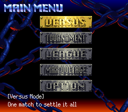
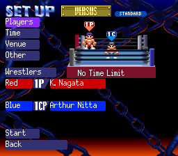
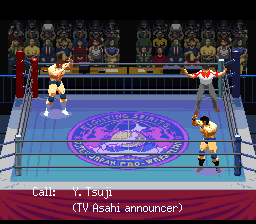
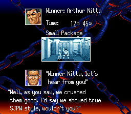
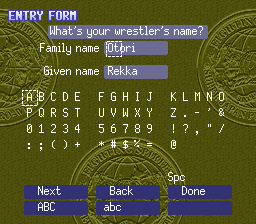
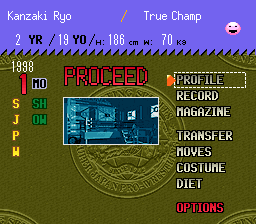
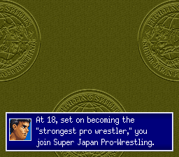
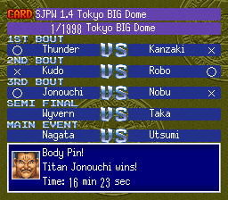

# Screenshots

Jikkyou Power Pro Wrestling '96 - Max Voltage with the English patch, taken in Mesen.

## Main Menu

The mode buttons and the screen title are redrawn in English, and the line at the bottom describes each mode.

## Match Setup

Menus, rule names and the wrestlers' names are in English throughout the setup screens.

## Match

The opening caption naming the commentator is translated.

## Winner Interview

The interview questions and every wrestler's answers are translated.

## Entry Form

The kana name grid is replaced with an English letter grid, so career wrestlers get Western names.

## Career Hub

The hub's menu and labels are redrawn in English.

## Story

The whole Max Voltage story is translated, with the promotions and wrestlers given English names.

## Show Card

The card title, bout names and result lines are in English, with the shortened roster names that fit the screen.
